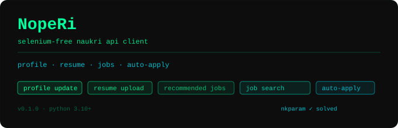

<p align="center">
  
</p>

# NopeRi — Production Job Application Automation Agent

A production-grade, modular, Selenium-free Naukri.com automation agent powered by clean layered architecture, robust browser impersonation, and AI-assisted job matching.

Login, search, filter, score, answer questionnaires, and apply — completely headless, reliable, and secure.

**Status:** 🟢 Production Ready — Fully Modularized & Refactored (November 2026)  
**Security:** Zero credential leakage, centralized secret masking in logs, secure localhost-only UI, cross-platform Windows/Linux support.

---

## 🏛️ Layered Architecture

The application has been restructured into an enterprise-ready modular architecture:

```
LME/
├── backend/
│   ├── core/                    # Centralized config, logging, exceptions, constants
│   │   ├── config.py            # Deep-merge ConfigManager with env & collision protection
│   │   ├── constants.py         # Static Naukri URLs, RSA public keys, App IDs
│   │   ├── exceptions.py        # Typed exception hierarchy
│   │   └── logging.py           # Rotating loggers with SecretMaskingFilter
│   ├── models/                  # Strongly typed dataclasses
│   │   └── models.py            # Job, NaukriSession, RunStats, Question, etc.
│   ├── storage/                 # Data access layer
│   │   ├── applied_jobs_repo.py # SQLite + CSV dual-write repository (16-char SHA-256 dedup)
│   │   ├── token_pool_repo.py   # NkparamDB SQLite token pool
│   │   └── cache_repo.py        # JsonCache for AI scores & questionnaire answers
│   ├── integrations/            # External APIs and third-party gateways
│   │   ├── naukri/              # Pure Naukri REST API client & BotGuard
│   │   │   ├── session.py       # Browser impersonation (httpcloak -> curl_cffi fallback)
│   │   │   ├── crypto.py        # Pure-Python RSA signing & Node.js BotGuard vid bridge
│   │   │   ├── extractors.py    # Form key discovery & regex extractors
│   │   │   ├── retry.py         # Exponential backoff retry decorator
│   │   │   ├── auth.py          # Naukri authentication & session resumption
│   │   │   ├── profile.py       # Profile updates, headline bump, resume upload
│   │   │   └── jobs.py          # Job search, recommended jobs, one-click apply
│   │   ├── ai/                  # AI client (OpenRouter / OpenAI)
│   │   └── telegram/            # Telegram Bot alert gateway
│   ├── services/                # Business logic orchestrators
│   │   ├── job_matching_service.py # 11-stage filter & ranking pipeline
│   │   ├── questionnaire_service.py# 4-tier questionnaire answering engine
│   │   ├── naukri_service.py    # High-level facade for Naukri API operations
│   │   ├── profile_service.py   # Automated profile headline & resume updater
│   │   └── application_service.py  # End-to-end search-to-apply orchestrator
│   ├── automation/              # Schedulers & Background Jobs
│   │   ├── scheduler.py         # APScheduler daemon with PID-based single-instance lock
│   │   └── cron_installer.py    # Linux/macOS crontab generator & installer
│   └── web/                     # Secure Local Web Management UI
│       ├── server.py            # 127.0.0.1 localhost server
│       └── handlers.py          # REST endpoints for setup wizard & dashboard
├── frontend/                    # Clean HTML/CSS/JS (Zero React overhead)
│   ├── templates/               # Extracted clean HTML templates
│   │   ├── setup_wizard.html    # 5-step interactive onboarding
│   │   └── dashboard.html       # Analytics & applied jobs dashboard
│   └── static/                  # Vanilla CSS & JavaScript assets
│       ├── css/style.css
│       ├── js/setup_wizard.js
│       ├── js/dashboard.js
│       └── img/logo2.svg
├── docs/                        # Complete Engineering Documentation
│   ├── REVERSE_ENGINEERING.md   # Initial teardown & dependency analysis
│   ├── ARCHITECTURE.md          # Full layered architecture specification
│   ├── SECURITY_AUDIT.md        # OWASP security findings & remediation
│   ├── SCHEDULER_ANALYSIS.md    # Automation & background job audit
│   ├── SETUP.md                 # Setup, configuration, and verification guide
│   └── REFACTORING_PROGRESS.md  # End-to-end conversation progress & change log
├── tests/                       # Automated Test Suite (36 tests)
│   ├── unit/                    # Unit tests for config, crypto, filters, logging, storage
│   └── integration/             # Integration tests for pipeline, scheduler, web server
├── cron/                        # Backward-compatible scheduling entry points
├── apply_agent.py               # Main CLI Entry Point
├── requirements.txt             # Managed Python dependencies
├── pytest.ini                   # Pytest path and execution configuration
└── .env.example                 # Environment variable template
```

---

## ✨ Core Capabilities

- **Headless Browser-Free Authentication:** Emulates Chrome browser headers with TLS fingerprinting (`httpcloak` with fallback to `curl_cffi`). Uses pure Python RSA encryption for `nkparam` and Node.js BotGuard integration for dynamic `vid` tokens.
- **11-Stage Intelligent Filtering:**
  1. Title/Role regex matching
  2. Experience range validation
  3. Strict Company & Title Veto blacklist
  4. Salary/CTC boundary check
  5. Work mode preferences (Remote, Hybrid, Onsite)
  6. Posted date freshness filter
  7. 16-char SHA-256 deduplication (SQLite + CSV)
  8. AI Semantic Relevance Scoring (0–100 via OpenRouter/OpenAI)
  9. Automatic rejection below configurable threshold
  10. Daily quota enforcement
  11. One-click easy apply payload generator
- **4-Tier Smart Questionnaire Answering:**
  1. Exact string match against predefined Q&A
  2. Case-insensitive substring match
  3. Persistent SQLite/JSON answer cache
  4. Context-aware AI synthesis using resume profile
- **Profile Bumping Automation:** Automatically toggles headline whitespace/punctuation to refresh profile recency on recruiter searches without altering visible text.
- **Background Automation & Safety:** APScheduler daemon with single-instance lock file (`.scheduler.pid`) preventing duplicate workers.
- **Real-Time Telegram Notifications:** Formatted Markdown alerts for application summaries, score rejections, and critical authentication warnings.
- **Zero-Credential-Leak Logging:** Rotating file logs (`logs/noperi.log`) with an automated `SecretMaskingFilter` censoring Bearer tokens, Telegram bot tokens, API keys, and passwords.

---

## ⚙️ Installation & Prerequisites

### Prerequisites
- **Python:** 3.10+ (recommended 3.11 or 3.12)
- **Node.js:** 14+ (required for generating Naukri's BotGuard `vid` security tokens)

### 1. Clone & Setup Virtual Environment
```bash
git clone <repo-url>
cd LME
python -m venv .venv

# Linux/macOS
source .venv/bin/activate

# Windows PowerShell
.venv\Scripts\Activate.ps1
```

### 2. Install Dependencies
```bash
pip install -r requirements.txt
```

### 3. Environment Configuration
Copy `.env.example` to `.env`:
```bash
cp .env.example .env
```
Populate your credentials:
```env
# Naukri Credentials
NAUKRI_USERNAME=your_email@example.com
PASSWORD=your_naukri_password

# AI Scoring (Optional)
OPENROUTER_API_KEY=sk-or-v1-...
# Or OpenAI direct:
OPEN_API_KEY=sk-...

# Telegram Alerts (Optional)
TELEGRAM_BOT_TOKEN=123456789:ABC-DEF1234ghIkl-zyx57W2v1u123ew11
TELEGRAM_CHAT_ID=123456789
```

---

## 🚀 Running the Application

### 1. Run Job Application Agent (CLI)
```bash
python apply_agent.py
```

### 2. Launch Interactive Web Setup Wizard
Opens a local browser wizard on `http://127.0.0.1:8765`:
```bash
python apply_agent.py --setup
```

### 3. Launch Analytics Dashboard
Opens the local statistics and application tracking dashboard:
```bash
python apply_agent.py --dashboard
```

### 4. Manage Applied Jobs & Veto Rules
```bash
# View last 50 applied jobs
python apply_agent.py --list-applied 50

# Remove a job ID from tracking (allowing re-application)
python apply_agent.py --remove-job 1234567890

# View company & title veto rules
python apply_agent.py --veto list

# Add a company or title to veto list
python apply_agent.py --veto add company "TCS"
python apply_agent.py --veto add title "Intern"

# Remove a company or title from veto list
python apply_agent.py --veto remove company "TCS"
```

### 5. Automated Schedulers
```bash
# Start background APScheduler daemon (with single-instance lock)
python -m backend.automation.scheduler

# Or install Linux/macOS crontab
python -c "from backend.automation.cron_installer import install_cron; install_cron('09:00', '1,2,3,4,5')"
```

---

## 🧪 Testing

The refactored codebase includes comprehensive unit and integration test coverage:

```bash
# Run the entire test suite
pytest -v

# Run only unit tests
pytest tests/unit/ -v

# Run only integration tests
pytest tests/integration/ -v
```

*Note: Live network tests requiring real Naukri credentials (`tests/test_api.py`) are automatically skipped when credentials are not configured in `.env`.*

---

## 📚 Detailed Documentation

Comprehensive documentation is available in the `docs/` folder:
- [Reverse Engineering Report](docs/REVERSE_ENGINEERING.md): Comprehensive teardown of original scripts and logic.
- [Layered Architecture Spec](docs/ARCHITECTURE.md): Architectural layers, design patterns, and interfaces.
- [Security Audit Report](docs/SECURITY_AUDIT.md): Security findings (SEC-01 to SEC-08), credential handling, and mitigations.
- [Scheduler & Automation Audit](docs/SCHEDULER_ANALYSIS.md): Concurrency analysis, locking, crontab behavior, and failure modes.
- [Setup & Operation Guide](docs/SETUP.md): Step-by-step setup, troubleshooting, and production deployment.
- [Refactoring Progress Log](docs/REFACTORING_PROGRESS.md): Detailed log of all transformations and backwards-compatibility guarantees.

---

## ⚖️ License & Ethical Usage
This software is provided for educational and personal automation purposes only. Ensure compliance with Naukri.com terms of service and relevant local regulations. The maintainers are not responsible for account bans or automated misuse.
