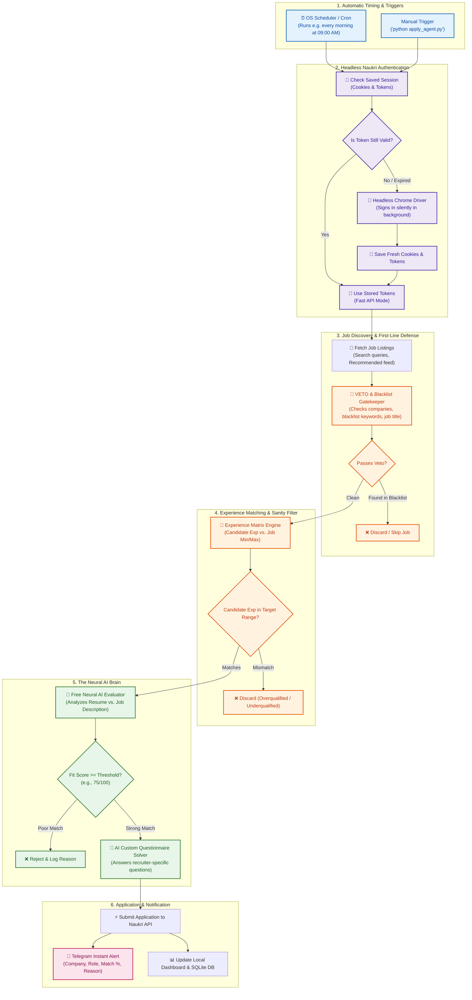

# LME Architecture, Workflow & Interview Q&A Guide

An executive, plain-English reference manual for Project Managers, non-technical stakeholders, and candidates discussing this project in engineering and system design interviews.

---

## 1. Executive Summary & Architecture Flow

---

## 2. Core Components Explained in Plain Language

### 1. Scheduler (The Automated Alarm Clock)
* **Real-World Analogy**: Like setting an automatic coffee maker that brews your coffee at 8:00 AM every weekday without waking you up.
* **How It Works**:
  * On Windows, it registers an OS task using native `schtasks.exe` / Windows Task Scheduler.
  * On Linux / macOS, it registers an OS cron job (e.g. `0 9 * * 1-5`).
  * The machine wakes up, runs the search and application cycle, alerts you on Telegram, and shuts down cleanly without staying open in the background.

### 2. Headless Naukri Login (The VIP Lounge Pass)
* **Real-World Analogy**: Like having a VIP wristband. When you show up, the guard checks your band and lets you walk in instantly. Only if your wristband is expired do you have to show your passport at the desk.
* **How It Works**:
  * **Fast Path (API Token)**: Reads saved session tokens from `cookies.json`. If still valid, it communicates directly with Naukri's internal REST API endpoints in milliseconds. No visual browser is launched.
  * **Fallback Path (Headless Chrome)**: If tokens are expired, it silently opens Chrome in the background (invisible to the user), logs in with your credentials, extracts the newly refreshed auth cookies, saves them locally, and closes Chrome.

### 3. Veto Blacklist (The Office Bouncer)
* **Real-World Analogy**: A bouncer at the door holding a list of blacklisted names. If a job comes from a blacklisted company or mentions a red flag, it gets kicked out immediately.
* **Why It Matters**: Prevents wasting time or AI compute on roles you will never accept (e.g. your current employer, unpaid internships, 3-year employment bonds, or night shifts).
* **Speed**: Evaluates via regular expressions in **under 1 millisecond**—saving expensive AI API calls.

### 4. Experience Matcher (The Height Requirement Check)
* **Real-World Analogy**: The measurement line at a theme park ride. If you're too short or too tall, you don't enter.
* **How It Works**:
  * If a candidate has 5 years of experience:
    * Job A asks for 3–6 years: **Match** (Sweet spot).
    * Job B asks for 10–15 years: **Skipped** (Underqualified).
    * Job C asks for 0–1 years: **Skipped** (Overqualified; applying damages your Naukri profile response metrics).

### 5. Neural AI Brain & Questionnaire Solver (Your Dedicated Career Agent)
* **Real-World Analogy**: Having an experienced hiring manager sitting with your physical resume, reading the job description line-by-line, scoring how well you fit, and answering custom recruiter questions for you.
* **How It Works**:
  * Compares your actual parsed resume (achievements, primary tech stack, total tenure) against the Job Description (JD).
  * Generates an objective Match Score (0–100%). If above your threshold (e.g. 75%), it moves to apply.
  * Solves custom recruiter screening questions (e.g., *"How many years of experience do you have with Kafka microservices, and what is your notice period?"*) by drawing verified facts from your profile.
  * Uses OpenRouter's free tier (`openrouter/free`), meaning zero API bill or credit card required.

### 6. Telegram Instant Notifier (Your Personal Assistant)
* **Real-World Analogy**: An assistant tapping your shoulder to say: *"Just applied you to Google for Senior Backend Engineer. Match score was 89% because of your Kubernetes and Python background."*
* **How It Works**:
  * Uses the Telegram Bot API over secure HTTPS.
  * Delivers a summary directly to your mobile phone within 1 second of every successful application.

---

## 3. High-Value Interview Q&A (Technical & System Design)

When discussing this project in interviews (Full-Stack, Backend, Automation, or System Design), use the natural, structured explanations below.

---

### Q1: "Can you explain the high-level architecture of your job automation system?"
> **How to Answer in Plain English**:
> "I designed LME around an event-driven, multi-stage filtering pipeline with three main layers:
> 1. **Data Acquisition & Authentication Layer**: Interacts with Naukri using session-token caching to make lightweight HTTP API calls, falling back to a headless browser only when session tokens expire.
> 2. **Rule-Based Pre-Filtering (Gatekeeper)**: Before invoking any AI, jobs are screened through a high-speed veto filter (blacklisted companies, negative keywords, salary ranges) and an experience-compatibility matrix. This filters out 80%+ of irrelevant jobs in sub-milliseconds without incurring latency or LLM overhead.
> 3. **Neural Semantic Matching & Application**: For qualified leads, an LLM evaluates the candidate's resume against the job description, scores the fit, crafts responses for mandatory recruiter questionnaires, and dispatches the application. Finally, it records the transaction in an SQLite database and pushes real-time mobile notifications via a Telegram bot."

---

### Q2: "Why didn't you just use Selenium or Playwright for the entire application flow?"
> **How to Answer in Plain English**:
> "Full browser automation (like Selenium or Playwright) is resource-heavy, slow, and prone to UI element breakage whenever the platform updates its CSS or DOM layout.
> Instead, I implemented a **Hybrid Headless Strategy**:
> * We inspect and reverse-engineer the underlying REST API payloads that the web app uses.
> * We only use headless Chrome once to capture authenticated session cookies and headers.
> * Once we have valid session tokens, 99% of job searches, evaluations, and submissions happen via direct, lightweight HTTPS REST requests.
> This cut our job application cycle time from ~25 seconds per job down to **less than 2 seconds**, dramatically reduced CPU and memory usage, and eliminated DOM flake."

---

### Q3: "How did you prevent the AI costs from scaling out of control?"
> **How to Answer in Plain English**:
> "I used a two-part cost optimization strategy:
> 1. **Early-Exit Gatekeeper**: We never send raw job listings directly to an LLM. We first apply deterministic checks—Veto keywords, blacklisted company names, and experience min/max boundaries. If a candidate has 4 years of experience and the role asks for 12, it is dropped instantly with zero LLM tokens spent.
> 2. **Free Router Model Architecture**: We integrated with OpenRouter's free router (`openrouter/free`). It dynamically routes requests to available free-tier high-capacity models (like Meta LLaMA 3.1 8B or Mistral) without needing paid credits, while our backend handles HTTP 429 rate limits gracefully with exponential backoff."

---

### Q4: "How does the system handle recruiter screening questions that require specific answers?"
> **How to Answer in Plain English**:
> "Many job portals require candidates to answer open-ended or drop-down screening questions before submitting—such as notice period, current compensation, or specific framework experience.
> * We pass three things to the LLM: the candidate's parsed resume, their configured preferences (e.g. notice period, willingness to relocate), and the recruiter's exact question.
> * We enforce a structured output schema (JSON) where the model provides a direct answer and a brief justification based only on factual data in the resume, preventing hallucinations.
> * The service then injects these answers into the multipart submission payload."

---

### Q5: "How do you ensure user privacy and security with credentials and session tokens?"
> **How to Answer in Plain English**:
> "1. **Zero Hardcoded Secrets**: All sensitive credentials—Naukri login, Telegram Bot tokens, and API keys—are kept strictly in local environment variables (`.env`) which are git-ignored.
> 2. **Local Data Sovereignty**: All application state, applied job histories, and resumes remain on the local machine in SQLite; nothing is sent to any third-party analytics server.
> 3. **OS-Level Variable Collision Prevention**: On Windows, the system environment variable `%USERNAME%` defaults to the OS user account name (e.g., PRAVEEN). We built a dedicated configuration sanitization check to ensure the application explicitly binds to `NAUKRI_USERNAME` and validates email structure before attempting authentication."

---

### Q6: "What happens if Naukri's authentication tokens expire mid-run?"
> **How to Answer in Plain English**:
> "The API client monitors response status codes. If an endpoint returns an HTTP 401 Unauthorized or an authentication failure flag, the system catches the exception and triggers an automatic session refresh hook:
> 1. It invalidates the in-memory token cache.
> 2. It spawns the headless driver to re-authenticate and fetch new session cookies.
> 3. It writes the updated tokens to disk and retries the failed request without crashing the batch run."

---

### Q7: "If this system had to scale to thousands of users, how would you redesign it?"
> **How to Answer in Plain English**:
> "Right now, LME is a single-tenant local desktop automation. To scale it into a distributed multi-tenant SaaS:
> 1. **Distributed Task Queue**: Use Celery or Temporal with Redis/RabbitMQ to queue and distribute application tasks across worker nodes.
> 2. **Proxy Rotation & IP Pooling**: Job boards rate-limit repetitive requests coming from single IP addresses. We would integrate residential proxy pools (with sticky sessions per user) to mirror human browsing.
> 3. **Encrypted Vault**: Store user credentials and session tokens in an encrypted secrets manager (such as HashiCorp Vault or AWS KMS).
> 4. **Worker Isolation**: Run headless browser sessions in lightweight, ephemeral Docker containers to isolate sessions and ensure secure credential separation."

---

## 4. Key Takeaways for Project Managers & Non-Tech Leaders

| Metric / Feature | What It Delivers |
| :--- | :--- |
| **Time Saved** | Reduces daily manual job searching and applying from 2–3 hours to **0 minutes of manual effort**. |
| **Precision** | Only applies to roles where the candidate meets experience and skill requirements—preventing spamming. |
| **Safety First** | Never applies to your current company or blacklisted agencies. |
| **Operating Cost** | **$0.00** running cost by utilizing free AI models and local OS schedulers. |
| **Visibility** | Complete audit trail on a local dashboard plus instant mobile alerts on Telegram. |
