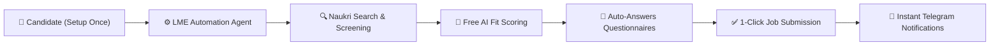
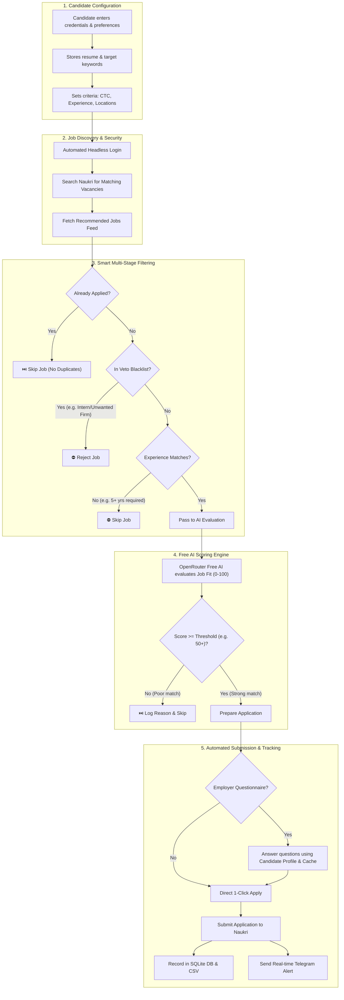

# LME Automation Agent — Executive & Non-Technical Overview

This guide explains how the **LME Job Application Automation Agent** works using clear visual diagrams and non-technical language for Project Managers, recruiters, and stakeholders.

---

## 1. High-Level Concept

Think of LME as an **intelligent digital assistant** that handles job hunting on Naukri 24/7 without opening a browser:

---

## 2. End-to-End Workflow Diagram

---

## 3. How It Works (For Non-Tech Stakeholders)

| Stage | What Happens | Why It Matters |
| :--- | :--- | :--- |
| **1. Fast & Headless Login** | Connects to Naukri securely in milliseconds without opening heavy browser windows. | Fast, lightweight, and uses minimal computer memory. |
| **2. Intelligent Filtering** | Checks jobs against your blacklist (e.g. internships, unwanted companies) and years of experience. | Prevents spam applications and protects your professional profile. |
| **3. Duplicate Defense** | Generates a 16-character digital fingerprint for every job vacancy. | Ensures you **never** accidentally re-apply to the same company posting twice. |
| **4. Free AI Matching ($0 Cost)** | Evaluates the job description against your resume and assigns a fit score (0–100). | Only roles with a genuine match get applied to. |
| **5. Screening Forms** | Automatically fills in questions like notice period, location preference, and expected CTC. | Handles complex multi-step application forms effortlessly. |
| **6. Profile Freshness & Alerts** | Periodically updates your profile headline on Naukri and sends real-time Telegram updates. | Keeps your resume at the top of recruiter search results 24/7. |
