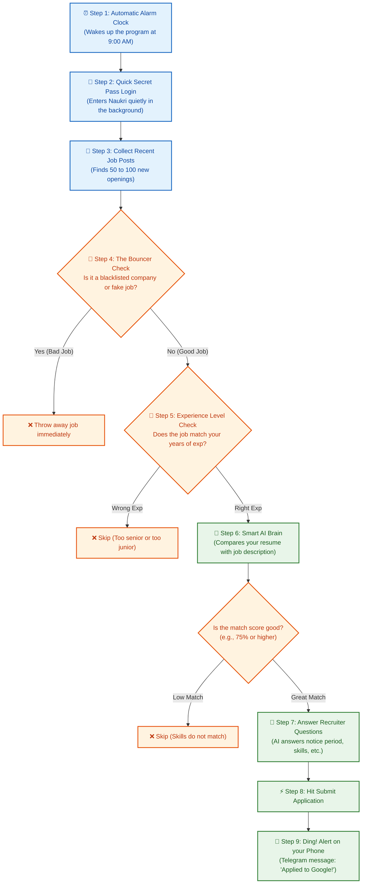

# LME Simple Beginner Guide & Interview Prep (For Freshers)

> **Welcome!** If you are a fresher or preparing for your first job interviews, this guide explains how our project **LME** works using very simple, real-world examples. There is no confusing jargon here—just simple stories and straightforward Q&As that you can comfortably speak to in any interview.

---

## 💡 The Real Problem & Why We Built This Project (The Story to Tell in Interviews)

Whenever an interviewer asks: *"Why did you build this project?"* or *"What was the problem statement?"*, here is the polished, natural explanation you can say:

> "Currently, many of us are actively looking for jobs. Anyone who has used Naukri knows that to get noticed by recruiters, you must update your profile early every morning at a specific time. If you update your profile, Naukri's algorithm ranks you at the top of recent searches, making your profile visible to active recruiters. 
>
> On top of that, finding relevant jobs requires manually searching through hundreds of listings, reading job descriptions to see if skills match your resume, and filling out repetitive application forms. Doing this manually every single day is tedious, time-consuming, and repetitive.
>
> To solve this, we built **LME (Naukri Automation Agent)**:
> 1. **Secure Login & Profile Refresh**: The agent reads our credentials safely stored in a local `.env` secrets file, logs into Naukri, and automatically refreshes our profile so recruiters see us at the top of search results every morning.
> 2. **Targeted Job Search**: It searches for jobs matching our specific keywords and criteria.
> 3. **AI Resume vs. Job Fit Scoring**: It sends the job description alongside our parsed resume to an LLM using a free OpenRouter API key (`openrouter/free`). The LLM calculates an objective match score. If the score is below the threshold (e.g. 50%), it automatically rejects the job. If it is 50% or higher, the agent proceeds to apply.
> 4. **Duplicate Prevention via SQLite**: Once applied, the job details are recorded in a local SQLite database so the agent never wastes time applying to the same job twice.
> 5. **Instant Mobile Alerts via Telegram**: As soon as the application is submitted, an integrated Telegram bot sends a message directly to our phone with the company name, role, and match score so we can track everything in real time."

---

## ⚡ The Whole System in 5 Quick Lines (How It Works Naturally)

If someone asks: *"How does this whole project work from start to finish?"*, here is the 10-second summary:

1. **⏰ It Wakes Up by Itself**: An automated morning timer turns on the program quietly without you touching your laptop.
2. **🔑 It Slips Into Naukri**: It uses a saved login pass to fetch fresh job openings in 1 second without opening any slow browser window.
3. **🚫 The Bouncer Checks the Door**: It immediately throws away bad companies (like your current boss, fake consultancies, or unpaid jobs) and skips roles requiring the wrong years of experience.
4. **🧠 The Free AI Brain Reads Your Resume**: It compares your skills with the job description; if it's a great match (75%+), it writes honest answers to recruiter questions (like notice period and key skills).
5. **📱 Ding! You Get an Alert**: It submits the application on Naukri and sends an instant message to your **Telegram** app with the company name, role, and match score!

---

## 1. The Simple Big Picture

Imagine you are looking for a job every single day. 
Usually, you would:
1. Wake up and log into Naukri.
2. Search through hundreds of jobs.
3. Skip the bad companies or jobs asking for 10 years of experience.
4. Read the job description to see if you actually know the skills.
5. Answer questions like *"What is your notice period?"*.
6. Click Apply and repeat this 50 times.

**LME does all of this for you automatically while you sleep!**

Here is the simple picture of how it works step-by-step:

---

## 2. Real-World Stories to Explain Each Step

When the interviewer asks: *"How does this part work?"*, don't use heavy computer terms. Use these simple stories:

### Step 1: The Alarm Clock (Scheduler)
* **Simple Story**: Just like setting an alarm on your phone to wake you up at 7:00 AM, the computer has an alarm clock called a "Task Scheduler". At 9:00 AM every morning, it turns on the program, lets it apply to jobs, and then turns it off.

### Step 2: The Secret Pass (Fast Login)
* **Simple Story**: When you go to a college event, you show your ID card once and get a paper wristband. For the rest of the day, you just show your wristband and walk straight in—you don't have to show your full ID every single minute. 
* Our program saves a "wristband" (called a login token). When the wristband expires, it quietly opens a hidden browser in the background, logs in once, gets a new wristband, and closes the browser.

### Step 3 & 4: The Bouncer at the Club Door (Veto Blacklist)
* **Simple Story**: The club bouncer has a list of people who are not allowed inside. 
* In our project, the bouncer immediately blocks:
  * Your current company (so they don't know you are applying!).
  * Consultancy companies with bad 3-year bonds.
  * Fake or unpaid internships.
* Because the bouncer checks this in 1 second, we don't waste any time or computer energy on bad jobs.

### Step 5: The Theme Park Height Check (Experience Matcher)
* **Simple Story**: At an amusement park ride, there is a sign that says *"You must be between this height and that height to ride"*.
* If you have 1 year of experience, and a job asks for a "15-year Director", the program skips it. It also skips jobs asking for 0 experience if you are looking for senior roles.

### Step 6: The Smart Brain (AI Resume Matcher)
* **Simple Story**: Imagine your college professor sitting with your printed resume in one hand and the job description in the other. They read both and say: *"Hey, this job needs Python and SQL. Your resume has both! You are an 85% match."*
* We use a free AI model (`openrouter/free`) that does this reading for us at **\$0 cost**.

### Step 7: Answering Questions (Questionnaire Solver)
* **Simple Story**: Sometimes a company asks: *"What is your notice period?"* or *"Do you know React?"*.
* The AI looks at your profile information and writes a polite, professional reply directly for the recruiter.

### Step 8 & 9: The Phone Alert (Telegram Bot)
* **Simple Story**: As soon as the application is sent, your phone buzzes on Telegram:
  > *"Applied to Infosys for Python Developer! Match score: 85%."*
* You can sit with your friends drinking tea while your phone alerts you about jobs you applied to!

---

## 3. Top Interview Questions & Short, Natural Answers

Here are the exact questions an interviewer or manager will ask when looking at your diagram, along with simple, confident answers you can memorize and say.

---

### Basic Questions

#### Q1: "What is this project in one simple sentence?"
> **Answer**:  
> "It is an intelligent job assistant that runs on a schedule, finds suitable jobs on Naukri, checks if my resume matches the requirements using AI, applies automatically, and sends an alert to my phone on Telegram."

---

#### Q2: "What is a 'Veto Filter' and how does it work?"
> **Answer**:  
> "Think of the Veto Filter as a strict gatekeeper or a 'Do Not Enter' list. 
> * **What it is**: It is a simple configuration where we list things we completely refuse to accept—such as our current employer's company name, unpaid internships, 3-year bond contracts, night shifts, or consultancies.
> * **How it works**: Before sending any job to the AI, the code scans the job title, company name, and description. If it sees even one forbidden word from our blacklist, it says **'VETO'** (meaning 'I forbid this!') and throws the job away in less than 1 millisecond.
> * **Why it matters**: It stops our current boss from discovering we are job hunting, protects us from scam companies, and saves computer time."

---

#### Q3: "Why do we need the 'Bouncer' (Veto Filter) before the AI?"
> **Answer**:  
> "To save time and money! Checking a job with an AI takes 2 to 3 seconds. But checking a simple list of bad words or blacklisted companies takes less than a millisecond. By throwing away bad jobs first, we never waste AI power on jobs we would never take anyway."

---

#### Q4: "What happens if a job asks for 10 years of experience and I only have 1 year?"
> **Answer**:  
> "Our Experience Filter catches it right away. It checks the minimum and maximum years mentioned in the job post. If my experience doesn't fit within that range, it skips the job immediately."

---

#### Q5: "How does the AI know how to answer recruiter questions?"
> **Answer**:  
> "We provide the AI with a pre-saved profile sheet containing facts—like our current location, notice period, and core skills. When a recruiter asks a question, the AI reads those facts and writes a short, polite answer without making up any lies."

---

#### Q6: "Does this cost any money to run?"
> **Answer**:  
> "No, it is completely free! We use OpenRouter's free AI router (`openrouter/free`), our own computer's built-in scheduler, and a free Telegram Bot. The running cost is exactly zero."

---

### Slightly Technical Questions (Made Easy)

#### Q7: "Why didn't you open a browser window for every single job application?"
> **Answer**:  
> "Opening a browser like Chrome for 100 jobs is very slow, uses lots of computer memory, and crashes easily if a button changes position. Instead, we only open Chrome once to grab the login token, and then send fast, quiet internet messages (APIs) directly. It is 10 times faster and never hangs."

---

#### Q8: "What happens if your login session expires while the program is running?"
> **Answer**:  
> "The program notices that the website said 'Access Denied'. Instead of stopping or crashing, it quietly opens the background browser again, logs in with our saved password, gets a fresh new token, and continues applying where it left off."

---

#### Q9: "Where are my passwords and credentials saved? Is it safe?"
> **Answer**:  
> "Yes, it is very safe. All passwords and tokens are stored in a private `.env` file on our own local laptop. That file is ignored by Git, so it is never uploaded to GitHub or shared with anyone on the internet."

---

#### Q10: "Why did you use Telegram instead of sending an Email or WhatsApp message?"
> **Answer**:  
> "Telegram gives developers a free, official bot API that takes only 2 minutes to set up. WhatsApp requires business approvals and costs money, and emails often end up in the spam folder. Telegram messages arrive instantly on our phone as push notifications."

---

#### Q11: "Can multiple people use this project, or is it only for one person?"
> **Answer**:  
> "Anyone can use it! We built a simple web setup wizard. A new user just opens the page, uploads their own resume PDF, enters their own Naukri login and preferences, and the system automatically updates itself for them."

---

## 4. Quick Summary Checklist to Remember in Interviews

If the interviewer gives you 60 seconds to summarize, just mention these **5 points**:
1. **Automation**: Starts on an automatic schedule without manual clicking.
2. **Speed**: Uses lightweight API calls instead of opening heavy Chrome windows every time.
3. **Smart Filters**: Fast bouncer filter kicks out bad companies and wrong experience levels.
4. **AI Matcher**: Free AI compares your resume to the job description so you only apply to good fits.
5. **Real-Time Notification**: Sends instant updates to your Telegram app so you always know what happened.
