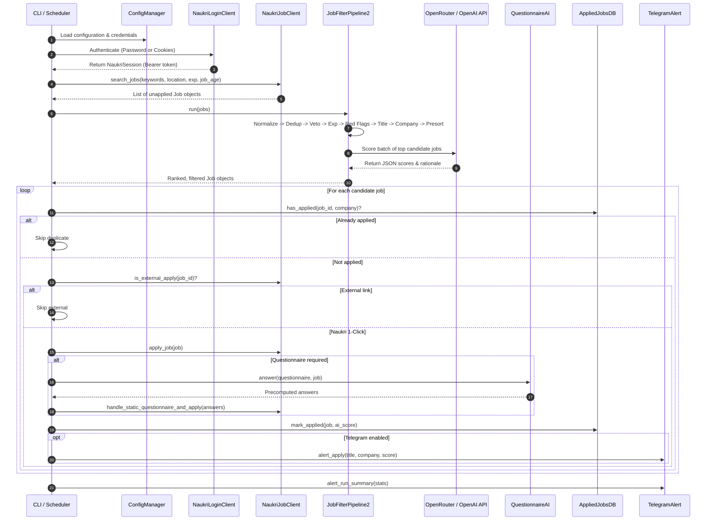

# REVERSE ENGINEERING SPECIFICATION
## Naukri Job Application Automation Agent (NopeRi)

**Document Version:** 1.0.0  
**Status:** Completed Analysis  
**Audience:** Software Architects, Backend Engineers, Security Engineers, QA Engineers  

---

## 1. Executive Summary

This document provides a comprehensive reverse-engineering analysis of the **NopeRi** Naukri job automation codebase. The application is an automated, headless agent designed to search for matching job vacancies on [Naukri.com](https://www.naukri.com), filter and rank listings using natural language processing and LLM scoring (via OpenRouter or OpenAI), automatically answer custom screening questionnaires, submit job applications, track application history in SQLite and CSV, maintain profile freshness by bumping headlines and re-uploading resumes on a schedule, and provide a web-based configuration wizard and visual analytics dashboard.

---

## 2. Directory Structure Analysis (Original)

```
NopeRi/
├── .env                       # Credentials and API keys (USERNAME, PASSWORD, OPEN_API_KEY)
├── .gitignore                  # Git ignore rules
├── apply_agent.py              # CLI entry point, batch pipeline orchestrator, dashboard generator
├── main.py                     # Demo / sandbox script with manual test flows
├── README.md                   # Project overview, installation, and usage instructions
├── requirements.txt            # Python dependencies
├── run.bat                     # Windows batch launcher (py apply_agent.py %*)
├── user_prompt.md              # Markdown candidate profile & scoring rubric for LLM
├── assets/
│   └── logo2.svg               # Project logo
├── cron/
│   ├── __init__.py             # Package marker
│   ├── profile_updater.py      # Profile headline updater and resume re-uploader
│   ├── scheduler.py            # APScheduler 3.x background scheduler daemon
│   └── telegram_alert.py       # Telegram notification integration via raw Bot API
├── src/
│   ├── __init__.py
│   ├── client/
│   │   ├── __init__.py
│   │   ├── job_classifier.py    # Multi-stage heuristic + LLM filter and ranking pipeline
│   │   ├── job_client.py        # Naukri internal job API client (search, recomm, apply)
│   │   ├── naukri_client.py     # Naukri authentication, session, profile & resume management
│   │   ├── questionnaire_ai.py  # Screening questionnaire resolution (cache, rules, LLM)
│   │   └── session.py           # HTTP session factory (httpcloak / curl_cffi Chrome impersonation)
│   ├── config/
│   │   ├── __init__.py
│   │   └── constants.py         # API endpoints, RSA public key, regex patterns
│   ├── exceptions/
│   │   ├── __init__.py
│   │   └── exceptions.py        # Custom exception classes
│   ├── models/
│   │   ├── __init__.py
│   │   └── models.py            # Dataclasses (Job, NaukriSession, ApplicationHistory, etc.)
│   └── utils/
│       ├── __init__.py
│       ├── botguardSdk_v1.min.js# Obfuscated Naukri BotGuard JavaScript SDK
│       ├── config_manager.py    # Configuration loader & manager for config.json & veto.json
│       ├── dbhandler.py         # SQLite & CSV persistence for applied jobs and nkparam pool
│       ├── extractors.py        # HTML and JavaScript token extraction utilities
│       ├── formkey.py           # MNJ script bundle resolution and formKey extraction
│       ├── nkparam_generator.py # RSA-based nkparam request header generator
│       ├── request_helper.py    # Exponential backoff retry decorator with jitter
│       ├── vid_generator.py     # Node.js bridge executing botguardSdk to produce vid header
│       └── web_setup.py         # Embedded HTTP server & single-page HTML setup wizard
└── tests/
    ├── __init__.py
    └── test_api.py             # Change-detection smoke tests (partially outdated)
```

---

## 3. Component Inventory & Responsibility Breakdown

| Component | File Path | Core Responsibility |
|---|---|---|
| **CLI Runner & Orchestrator** | `apply_agent.py` | Argument parsing, orchestrates fetch → filter → score → apply loop, runs setup wizard, renders HTML dashboard, manages vetoes. |
| **Demo Sandbox** | `main.py` | Standalone script demonstrating login, search, apply, and history. |
| **Auth & Profile Client** | `src/client/naukri_client.py` | Login via email/password or browser cookies, OTP challenge handling, profile headline/summary updates, resume upload, formKey harvesting. |
| **Job Search & Apply Client** | `src/client/job_client.py` | Communicates with Naukri's `/jobapi/v3/search`, `/jobapi/v2/search/recom-jobs`, `/jobapi/v4/job/{id}`, and `/cloudgateway-workflow/.../apply`. Handles nkparam signing and questionnaire submissions. |
| **Job Filtering & Scoring** | `src/client/job_classifier.py` | Implements `JobFilterPipeline2`: normalization, deduplication, hard vetoes, experience filtering, regex red-flags, software title filtering, company vetoes, tech-stack presorting, and batched LLM scoring. |
| **Questionnaire AI** | `src/client/questionnaire_ai.py` | Resolves employer screening questions using a 4-tier resolution hierarchy: `qa_cache.json` → `common_qa` rules → batched LLM request → static heuristics. |
| **HTTP Session Factory** | `src/client/session.py` | Creates browser-impersonating HTTP sessions using either `httpcloak` (`chrome-latest`) or `curl_cffi` (`chrome124`). |
| **Configuration Manager** | `src/utils/config_manager.py` | Loads, deep-merges, and saves `config.json`, `veto.json`, and `user_prompt.md`. Resolves AI endpoint, API keys, and headers. |
| **Data Persistence** | `src/utils/dbhandler.py` | `AppliedJobsDB` manages SQLite `applied_jobs.db` and CSV `applied_jobs.csv` using 16-character SHA-256 job+company hash deduplication. `NkparamDB` manages SQLite `nkparams.db` token pool. |
| **Security & Crypto** | `src/utils/nkparam_generator.py` & `src/utils/vid_generator.py` | Generates RSA-encrypted `nkparam` headers and Node.js-driven BotGuard `vid` headers to bypass Naukri bot protection. |
| **Network Resilience** | `src/utils/request_helper.py` | `@with_exponential_retry` provides exponential backoff, jitter, and transient HTTP status code (429, 5xx) retries. |
| **Setup Wizard** | `src/utils/web_setup.py` | Local web server on port 8765 serving an embedded HTML/CSS/JS 5-step wizard to configure account, profile, AI, and scheduling. |
| **Background Scheduler** | `cron/scheduler.py` | APScheduler 3.x daemon running periodic profile headline refreshes and scheduled job application batches. |
| **Telegram Notifications** | `cron/telegram_alert.py` | Sends formatted Markdown notifications to Telegram chat for runs, applications, errors, and summaries. |

---

## 4. End-to-End Execution Flows

### 4.1 Application Pipeline (`apply_agent.py run_agent`)



### 4.2 BotGuard & Cryptographic Authentication Flow

1. **`vid` Generation (`vid_generator.py`)**:
   - Naukri protects `/central-login-services/v1/login` with BotGuard SDK.
   - When logging in, a temporary Node.js driver script executes `botguardSdk_v1.min.js` in a mocked browser environment (`window`, `document`, `navigator`, `location`).
   - The SDK generates a dynamic token encrypted using Naukri's RSA public key.
   - The token is passed as the `vid` HTTP header on the login request.
2. **`nkparam` Generation (`nkparam_generator.py`)**:
   - Naukri's search endpoint `/jobapi/v3/search` and job details endpoint `/jobapi/v4/job/{id}` require an encrypted `nkparam` header.
   - Formatted as `v0|{timestamp_ms}|121_{page_type}` (e.g. `121_srp` or `121_{job_id}`).
   - Encrypted with Naukri's 512-bit RSA public key (`PUBLIC_KEY` in `constants.py`) using PKCS#1 v1.5 padding and Base64 encoded.
3. **Session Persistence**:
   - Successful authentication yields `nauk_at` (access token / Bearer token) and `nauk_rt` (refresh token).
   - Saved cookies allow subsequent runs to bypass login completely.

---

## 5. Identified Architectural Issues & Vulnerabilities

### 5.1 Architecture & Code Organization
- **Monolithic Inlined UI**: `web_setup.py` contains 1,300+ lines of raw HTML, CSS, and JS embedded in a Python multi-line string. Similarly, `apply_agent.py` contains 80 lines of HTML/JS in `_handle_dashboard`. This prevents linting, formatting, syntax highlighting, and static file caching.
- **Scattered Logging**: Mix of `print()` statements with raw Colorama codes, `logging.basicConfig()` in some files, `logging.getLogger()` in others, and custom stream handlers attached to module loggers.
- **Direct Global File Access**: Hardcoded relative file paths (`config.json`, `veto.json`, `user_prompt.md`, `applied_jobs.db`, `qa_cache.json`, `score_cache.json`) scattered across different files, making execution from arbitrary working directories brittle.
- **Broken Tests**: `tests/test_api.py` imports `from src.client.job_client import JobClient`, but the class was renamed to `NaukriJobClient`. Tests fail immediately on import.

### 5.2 Security & Credential Management
- **Environment Variable Name Collision**: On Windows, `USERNAME` is an existing OS environment variable (e.g. `USERNAME=PRAVEEN`). In `profile_updater.py`, `os.getenv("USERNAME")` reads the Windows username instead of the Naukri email, causing login failure unless `NAUKRI_USERNAME` is used.
- **Session Tokens in Configuration**: `web_setup.py` stores `nauk_at` and `nauk_rt` in `config.json`. If `config.json` is exported or shared, session credentials are leakable.
- **Unauthenticated Local Server**: `web_setup.py` binds an `HTTPServer` on `localhost:8765` with `Access-Control-Allow-Origin: *` and accepts raw POST requests to save environment variables, trigger logins, or write crontabs without CSRF tokens.
- **Missing Dependencies in `requirements.txt`**: `requests` is imported in `telegram_alert.py`, `job_classifier.py`, `naukri_client.py`, and `request_helper.py`, but was omitted from `requirements.txt`.

---

## 6. Target Architecture Strategy

1. **Preserve All Business Logic**:
   - The algorithms for SEO key generation, nkparam encryption, BotGuard vid generation, multi-stage job filtering, questionnaire parsing, and SQLite/CSV tracking must remain 100% functionally identical.
2. **Decompose into Clear Layers**:
   - `core/`: Central configuration, logging, custom exceptions.
   - `integrations/`: Third-party external API clients (Naukri HTTP API, OpenRouter/OpenAI, Telegram Bot API).
   - `services/`: Business logic services (Authentication & Session, Job Search & Filtering, Questionnaire Solving, Application Submission, Profile Updating).
   - `automation/`: Schedulers, background tasks, crontab management.
   - `storage/`: SQLite and CSV repositories (`AppliedJobsRepository`, `TokenPoolRepository`).
   - `frontend/`: Clean, separated HTML/CSS/JS templates for the Setup Wizard and Dashboard.
   - `api/` / `web/`: Lightweight HTTP server serving the frontend and REST APIs.
3. **Robust Logging & Safe Secrets**:
   - Centralized rotating file logger (`logs/noperi.log`) and colored console logger.
   - Redaction filters to ensure passwords, tokens, API keys, and sensitive data are never logged.
4. **Comprehensive Automated Tests**:
   - Unit tests covering configuration, filter pipeline, crypto generators, database repositories, exception handling, and mocked external integrations.
